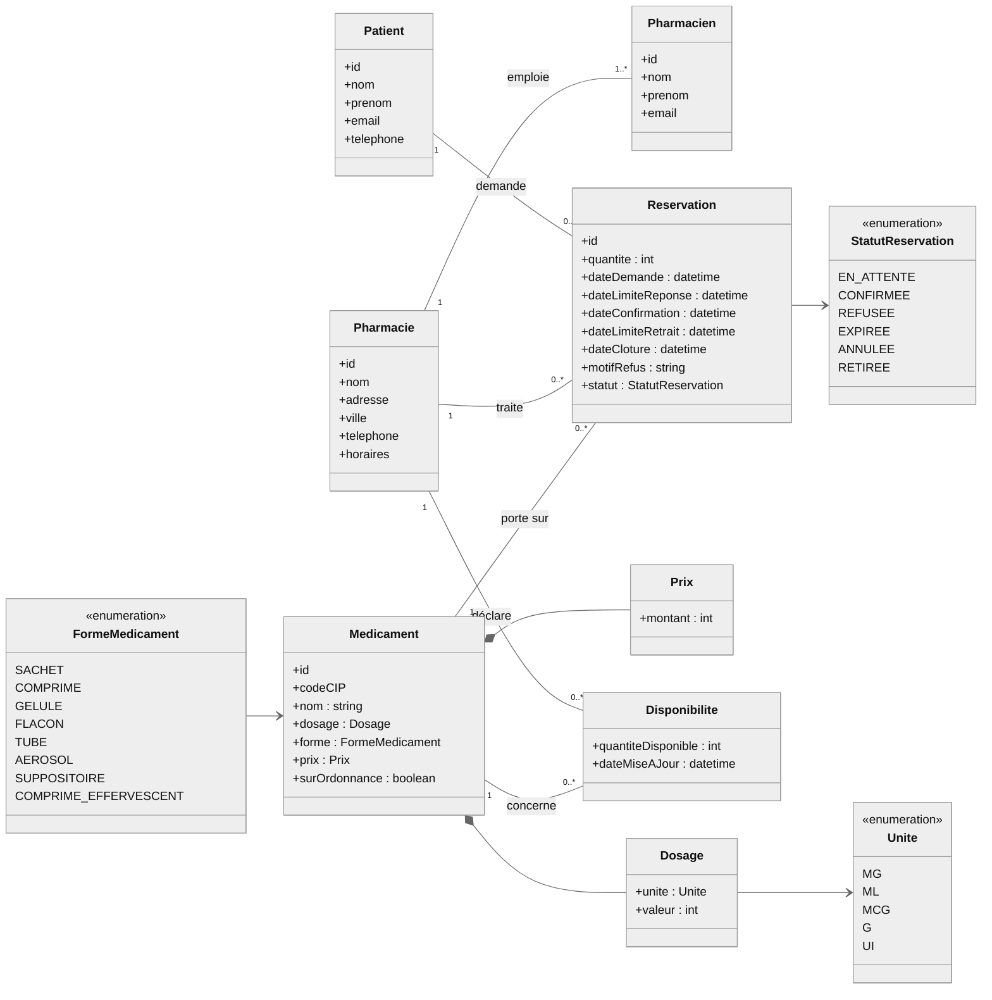
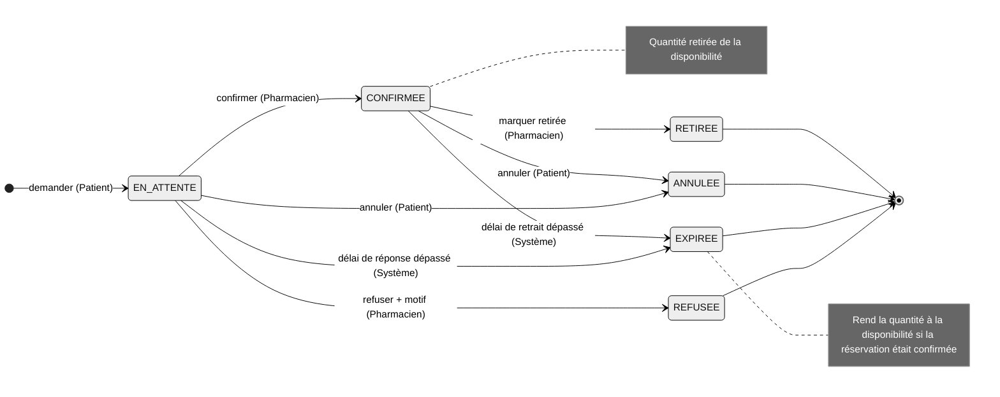
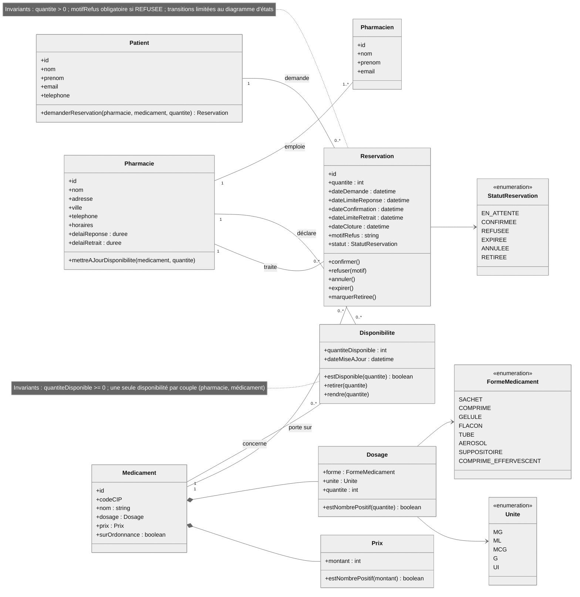

# LeBonMédoc : préparation

## 1. Les acteurs et leurs principales actions

- Pharmacie
    - Stocke les médicaments
    - Met à disposition les médicaments
- Pharmacien
    - Gère les disponibilités et les demandes de médicaments
    - Confirme / refuse une demande (avec un motif en cas de refus)
    - Marque une réservation comme retirée
    - Vérifie l'ordonnance au comptoir, au moment du retrait : cette vérification se fait hors plateforme, LeBonMédoc ne valide aucune ordonnance
- Patient
    - Recherche un médicament et les pharmacies qui le proposent
    - Demande la réservation d'un médicament
    - Annule sa demande ou sa réservation
    - Retire le médicament au comptoir
- LeBonMédoc
    - Fait le lien entre les patients et les pharmacies
    - Permet la réservation de médicaments
    - Envoie la demande aux pharmacies
    - Fait expirer automatiquement les demandes sans réponse et les réservations non retirées

## 2. Glossaire des termes métier

| Terme | Définition |
| --- | --- |
| **Pharmacie partenaire** | Pharmacie inscrite sur LeBonMédoc qui publie ses disponibilités. |
| **Pharmacien** | Professionnel d'une pharmacie partenaire qui traite les demandes et reste responsable de la délivrance. |
| **Patient** | Personne qui recherche un médicament et demande sa réservation sur LeBonMédoc. |
| **Médicament** | Produit du catalogue, identifié par son code CIP (nom, dosage, forme). Un médicament = une dose (1 cachet) |
| **Médicament sur ordonnance** | Médicament qui ne peut être délivré que sur présentation d'une ordonnance, vérifiée par le pharmacien au comptoir. |
| **Disponibilité** | Quantité d'un médicament (unité) qu'une pharmacie déclare pouvoir réserver à un instant donné. |
| **Demande de réservation** | Requête d'un patient pour mettre de côté une quantité d'un médicament dans une pharmacie. |
| **Réservation** | Suivi d'une demande de réservation tout au long de son cycle de vie (en attente, confirmée, refusée, expirée, annulée, retirée). |
| **Confirmation** | Acceptation de la demande par le pharmacien. La quantité réservée est retirée de la disponibilité. |
| **Refus** | Rejet de la demande par le pharmacien, avec un motif. |
| **Motif de refus** | Raison donnée par le pharmacien lorsqu'il refuse une demande (rupture, médicament non délivrable…). |
| **Annulation** | Abandon de la demande ou de la réservation par le patient. Si la réservation était confirmée, la quantité est rendue à la disponibilité. |
| **Expiration** | Fin automatique d'une demande sans réponse, ou d'une réservation non retirée, une fois le délai dépassé. |
| **Délai de réponse** | Temps maximum, défini par chaque pharmacie, dont elle dispose pour confirmer ou refuser une demande. |
| **Délai de retrait** | Temps maximum, défini par chaque pharmacie, dont dispose le patient pour récupérer une réservation confirmée. |
| **Retrait** | Remise effective du médicament au patient, au comptoir. |
| **Quantité** | Nombre d'unités (comprimés, gélules…) d'un médicament. |
| **Prix** | En centimes |

## 3. Entités, propriétés et relations

## 4. Règles métier essentielles

- On ne peut demander une réservation que si le médicament est disponible dans cette pharmacie, et seulement pour une quantité inférieure ou égale à la disponibilité.
- Seule la pharmacie concernée peut confirmer ou refuser une demande. Un refus est accompagné d'un motif.
- Si la pharmacie ne répond pas dans le délai de réponse défini par la pharmacie, la demande expire.
- Si une réservation confirmée n'est pas récupérée dans le délai de retrait défini par la pharmacie, elle expire et la quantité est rendue à la disponibilité.
- La confirmation retire la quantité réservée de la disponibilité. L'annulation ou l'expiration d'une réservation confirmée la rend.
- Le service ne valide pas les ordonnances. Pour un médicament sur ordonnance, la vérification se fait au comptoir, sous la responsabilité du pharmacien.

## 5. États possibles d'une réservation

- REFUSEE, EXPIREE, ANNULEE et RETIREE sont des états finaux : aucune transition n'en sort.
- On ne peut pas passer directement de EN_ATTENTE à RETIREE. Il faut d'abord une confirmation.
- Une réservation confirmée ne peut plus être refusée.
- Seule la pharmacie concernée peut confirmer, refuser ou marquer une réservation comme retirée. Seul le patient qui a fait la demande peut l'annuler.

## 6. Modèle du domaine

- **La quantité est retirée de la disponibilité à la confirmation**, pas au moment de la demande.
- **Une réservation porte sur un seul médicament.**
- **Les délais de réponse et de retrait sont définis par chaque pharmacie.**
- **Le système ne vérifie pas les ordonnances** : `surOrdonnance` sert seulement à informer le patient.

## Notions DDD appliquées

| Notion | Définition | Dans LeBonMédoc |
| --- | --- | --- |
| Modèle riche | Les objets du domaine contiennent leurs données et leurs règles | `Reservation` vérifie elle-même ses transitions et ses délais dans `confirmer()`, `refuser()`… |
| Modèle anémique (à éviter) | Des objets qui ne contiennent que des données, avec les règles dans des services | Ce qu'on aurait si `Reservation` n'avait que des getters et que le service vérifiait tout |
| Entité | Objet qui a une identité et évolue dans le temps | `Reservation`, `Pharmacie`, `Patient` |
| Objet-valeur | Objet défini uniquement par ses valeurs, sans identité | `Dosage`, `Prix` |
| Invariant | Règle toujours vraie | `quantiteDisponible >= 0`, motif obligatoire si refusée |
| Agrégat | Groupe d'objets modifié uniquement à travers sa racine | `Reservation`, modifiée seulement par ses méthodes |
| Langage commun | Les mêmes mots dans le métier, le modèle et le code | Le glossaire, repris dans les noms de classes |

modèle anémique / modèle riche → traitement des données

objet autonome / autosuffisant

setters spécifiques

---

**A faire :** 

datesVerifications ( dans classe DatesReservation )

setters qui ont besoins du status de la réservation

délai de retrait et de réponse différent pour chaque pharmacie

reservation.retrait

reservation.refuser

invariant métier

agrégat